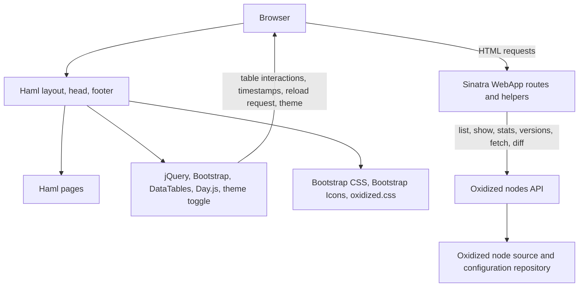

# Oxidized Web architecture and existing behavior

## Scope

This report describes the checked-in Oxidized Web repository before the UI redesign. The implementation is a Ruby gem extension for Oxidized. It does not own device storage or backup execution; those behaviors are provided by the Oxidized `nodes` interface.

## Dependency map

## Application structure

| Area | Files | Responsibilities |
|---|---|---|
| Extension setup | `lib/oxidized/web.rb` | Configures host, port, URI prefix, allowed virtual hosts, hidden node variables, and Puma server. |
| HTTP application | `lib/oxidized/web/webapp.rb` | Sinatra routes, response format selection, node API calls, encoding conversion, HTML escaping, diff preparation, and hidden-variable filtering. |
| Shared shell | `lib/oxidized/web/views/layout.haml`, `lib/oxidized/web/views/head.haml`, `lib/oxidized/web/views/footer.haml` | Navigation, assets, page body, and version footer. |
| Inventory and details | `lib/oxidized/web/views/nodes.haml`, `lib/oxidized/web/views/node.haml` | Device table and serialized node metadata. |
| Backup history | `lib/oxidized/web/views/versions.haml`, `lib/oxidized/web/views/version.haml` | Version list, download links, pairwise comparison link, and historical config display. |
| Diff | `lib/oxidized/web/views/diffs.haml` | Version selectors and side-by-side diff output. The route retains Oxidized's patch and computes old/new columns in `diff_view`. |
| Statistics and search | `lib/oxidized/web/views/stats.haml`, `lib/oxidized/web/views/conf_search.haml` | Per-node run/failure summary and regex configuration search results. |
| Browser assets | `lib/oxidized/web/public/css/oxidized.css`, `lib/oxidized/web/public/scripts/`, `lib/oxidized/web/public/weblibs/` | Status/diff styling, timestamp conversion, reload behavior, theme setting, Bootstrap, icons, jQuery, DataTables, and Day.js. |
| Tests | `spec/web*`, `spec/web/**` | Rack/Sinatra route contracts, JSON filters, node details, version/download/diff behavior, XSS escaping, and helpers. |

## Existing routes and behavior

| Route | Existing behavior |
|---|---|
| `GET /` | Redirects to `/nodes`. |
| `GET /nodes[.json]` | Lists nodes and decorates each with `status`, `time`, and a default group from existing `last` data. JSON remains available. |
| `GET /nodes/group/*[.json]`, `GET /nodes/model/*[.json]` | Filters the Oxidized node list by group or model, including groups containing `/`. |
| `GET /nodes/stats[.json]` | Returns each node's existing statistics. The HTML page calculates run totals, failures, rates, elapsed averages, and last success/failure from those stats. |
| `POST /nodes/conf_search[.json]` | Treats the submitted term as a Ruby regular expression, fetches each configuration, and returns matching node names. Invalid regular expressions yield no matches. |
| `GET /reload[.json]?node=…` | Reloads a node or the node list, then returns a message. The inventory's reload button calls this route. |
| `GET /node/fetch/<group>/<node>[.json|.text]` | Fetches a node configuration; plain text is the HTML page's existing download/raw endpoint. |
| `GET /node/next/<node>[.json]`, `PUT /node/next/<node>[.json]` | Triggers a node backup; PUT also accepts commit metadata in JSON. Existing redirect/JSON behavior is retained. |
| `GET /node/show/:node[.json]` | Shows node metadata and hides configured sensitive vars in a copied structure. |
| `GET /node/version[.json]?node_full=…` | Lists versions for a node/group. |
| `GET /node/version/view[.json|.text]` | Shows or returns a historical config version. HTML encoding conversion and escaping remain in the route. |
| `GET /node/version/diffs` | Gets the requested historical diff (or latest comparison), stats, and prepared old/new lines. |
| `POST /node/version/diffs` | Redirects a selected older OID back to the comparison GET route. |

## Current UI functionality to preserve

- Inventory: sortable/searchable/paginated DataTable, page-length choices, saved table state, column visibility, hidden IP by default, model/group filter links, download/history/backup actions, refresh, and source reload with success/failure feedback.
- Status: `success`, `no_connection`, and `never` are the current data-backed states. Node `time`/`mtime` are converted from epoch seconds into local browser time by Day.js.
- Stats: per-node run/failure counts and rates, average run duration, last success/failure, DataTables filtering, and saved state.
- Search: server-side configuration regex search and download link for each matching node.
- History: version numbering/timestamps, configuration download, and compare-with-previous action except for the oldest version.
- Config display: escaped HTML rendering, raw text mode, hidden node variables, and binary-content fallback.
- Diff: line counts, version selection, side-by-side added/deleted/context lines, and POST-to-GET comparison navigation.
- Theme: Bootstrap `data-bs-theme` light/dark setting persisted in browser `localStorage`.

## Safe UI redesign boundary

Presentation can be redesigned in the shared Haml shell, page Haml, custom CSS, and browser scripts. The overview may derive totals from `/nodes` status values and `/nodes/stats` history; “never” means no known last run in the current API representation. It must not claim vendor/model details beyond the available `model` string, a successful backup beyond existing status, or a change timeline that the routes do not expose. Existing Sinatra route definitions, JSON/text serialization, node API calls, URI-prefix handling, escaping, and sensitive-variable filtering are compatibility boundaries.

## Test coverage inventory (baseline)

- `spec/web/nodes_spec.rb`: list and group/model JSON filtering, including nested groups.
- `spec/web/node/version_spec.rb`: version listing links, grouped listing, historical config retrieval, text/JSON formats, binary fallback, comparison semantics, and nil-group behavior.
- `spec/web/node/show_spec.rb`: metadata output, hidden variables, copy safety, and HTML escaping.
- `spec/web/xss_spec.rb`: reflected and stored XSS escaping on version, diff, inventory, and stats pages.
- `spec/web/webapp_spec.rb`: binary conversion and diff helper behavior.
- Other `spec/web/*` files cover root redirect, configuration search, and application setup.

Browser-based visual and responsive tests are not part of the current repository test suite.
